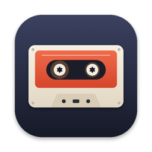
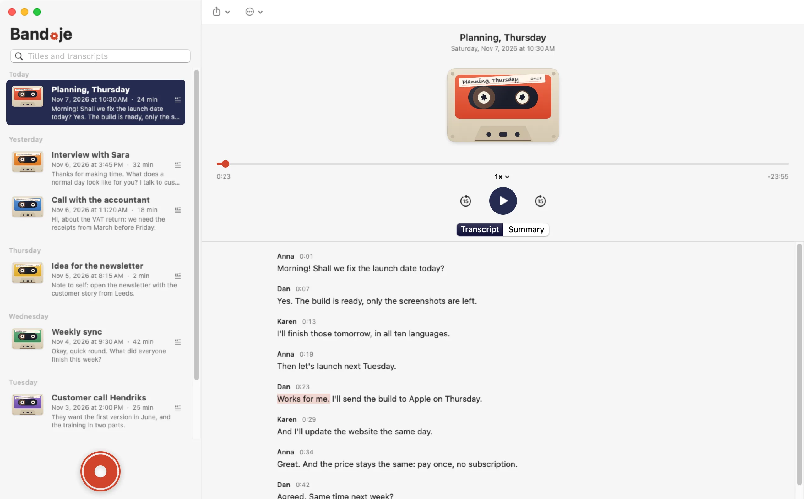
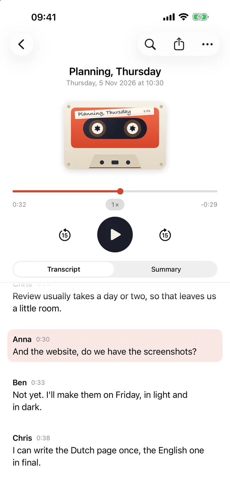
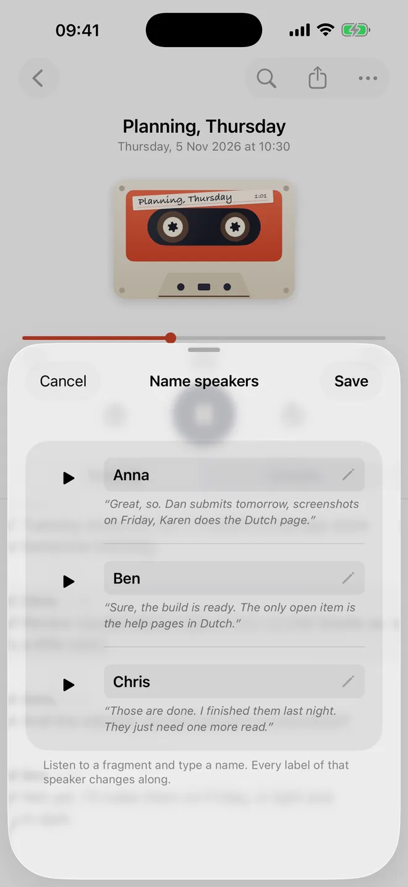
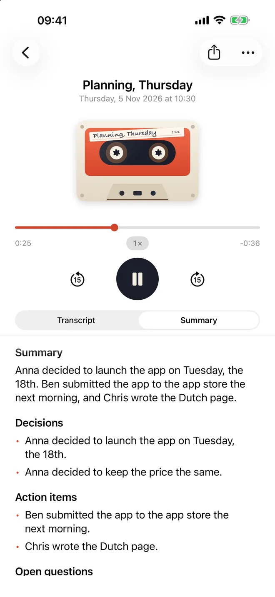
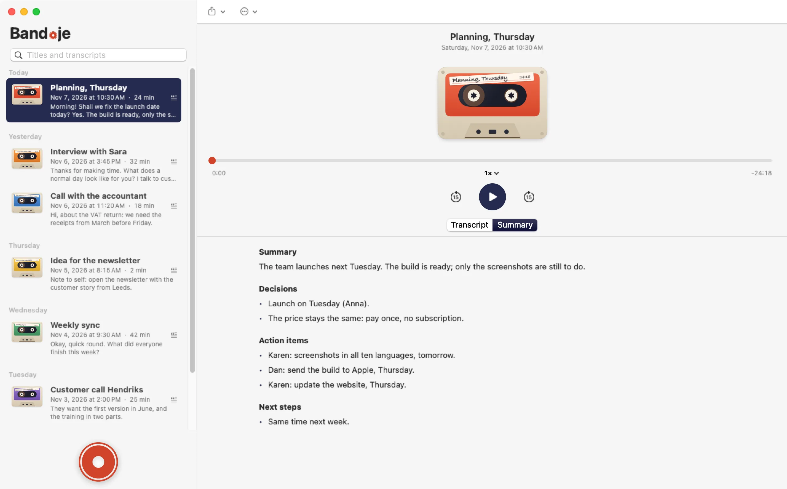

# Use the Source, Luke.

<p align="center">
  
</p>

<h3 align="center">Bandje records your conversations and turns them into text.<br>On your Mac, iPhone and iPad. All on device.</h3>

<p align="center">
  <a href="https://apps.apple.com/app/id6831353548"></a>
</p>

<p align="center">
  <b>One purchase for Mac, iPhone and iPad.</b> No subscription. No tokens. No account.<br>
  <a href="https://band.je">band.je</a>
</p>

<p align="center">
  <picture>
    <source media="(prefers-color-scheme: dark)" srcset=".github/readme/mac-04-window-dark.webp">
    
  </picture>
</p>

## What Bandje does

**⚡ Hyperfast prompt dictation on your Mac.** Press ⌃⌥⌘D, speak, and the text appears where your cursor is: in your editor, your mail, your AI prompt. Tap to start and stop, or hold to talk.

**🎙️ Record and transcribe.** Calls in any app (FaceTime, Zoom, Teams, Meet, phone calls through your Mac), meetings, lectures and memos. Bandje records both sides of a call, and no bot joins your meeting. Already have recordings? Import your voice memos, earlier calls and other audio files and transcribe those too.

**🗣️ Who said what.** Speaker diarization labels every voice. Listen to a short clip of each speaker and give them a name.

**📝 Summaries in your own templates.** Write a template as a plain text file (meeting notes, action items, a sales call, a lecture) and Bandje fills it in with Apple Intelligence, on your device.

**☁️ iCloud, if you want it.** Record on your iPhone, read on your Mac. Recordings, transcripts and summaries sync through your own iCloud Drive, not through us. Off by default.

**🌍 25 languages.** Bulgarian, Croatian, Czech, Danish, Dutch, English, Estonian, Finnish, French, German, Greek, Hungarian, Italian, Latvian, Lithuanian, Maltese, Polish, Portuguese, Romanian, Russian, Slovak, Slovenian, Spanish, Swedish and Ukrainian.

**🔗 A page that plays.** Share a transcript as one web page with the recording built in, for any browser. Or as PDF or text.

<p align="center">
  <picture>
    <source media="(prefers-color-scheme: dark)" srcset=".github/readme/ios-02-transcript-dark.webp">
    
  </picture>
  &nbsp;
  <picture>
    <source media="(prefers-color-scheme: dark)" srcset=".github/readme/ios-05-speakers-dark.webp">
    
  </picture>
  &nbsp;
  <picture>
    <source media="(prefers-color-scheme: dark)" srcset=".github/readme/ios-06-summary-dark.webp">
    
  </picture>
</p>

## All on device

Speech recognition, speaker labels and summaries run on your own Mac, iPhone or iPad. Your audio, transcripts and summaries never go to a server: there is no Bandje server. No account, no analytics, no tracking.

Don't take our word for it. That's what this repository is for: every line of Bandje's own code is here, and [`check-no-network.sh`](macos/scripts/check-no-network.sh) checks that it contains no networking code, on every push.

One honest footnote: the speech engine by [Desert Ant Labs](https://desertant.com) checks its license at most once a month per speech model. It sends a random install ID and version numbers, not tied to you. Never audio, never text. See the [privacy page](https://band.je/privacy/).

<p align="center">
  <picture>
    <source media="(prefers-color-scheme: dark)" srcset=".github/readme/mac-05-summary-dark.webp">
    
  </picture>
</p>

<p align="center">
  <a href="https://apps.apple.com/app/id6831353548"></a>
</p>

| | Requires |
|---|---|
| **Mac** | macOS 15 or later, Apple silicon. Summaries need macOS 26 with Apple Intelligence. |
| **iPhone** | iOS 26 or later |
| **iPad** | iPadOS 26 or later |

---

## Build it yourself

Bandje is free software under the GPL. Buying it on the App Store is the easy way, and it keeps this project going. If you'd rather build it yourself, here's how.

| Folder | What | Build instructions |
|---|---|---|
| [`macos/`](macos) | The Mac app: menu bar, window, call recording, dictation (Swift Package, `make`) | [macos/README.md](macos/README.md) |
| [`ios/`](ios) | The iPhone and iPad app (XcodeGen, Xcode 27) | [ios/README.md](ios/README.md) |

In short, on an Apple silicon Mac with Xcode 27:

```sh
cd macos
./scripts/fetch-models.sh   # Voz and Who speech models (~400 MB) into ~/Music/Bandje/.models, checked against models.lock.json
make app                    # build/Bandje.app
make test

cd ../ios
make build                  # needs xcodegen; uses the same models
```

Speech recognition (Voz) and speaker recognition (Who) by [Desert Ant Labs](https://desertant.com), under the Desert Ant Labs Source-Available License 1.0. They are fetched separately and are not covered by the GPL.

Each tag in this repository is the exact source of an App Store release: `macos-v1.0.0`, `ios-v1.0.0`, and so on. The code is developed elsewhere and published here per release, so this repository has one commit per release, not the day-to-day history.

## Contributing

Issues are welcome. Pull requests too: sign the [Contributor License Agreement](CLA.md) by ticking the box in the pull request template. See [CONTRIBUTING.md](CONTRIBUTING.md) for how a pull request makes its way into a release.

## License

Bandje's source code is licensed under the [GNU General Public License version 3](LICENSE) (GPL-3.0-only), with an additional permission (GPL section 7) to combine it with the Desert Ant Labs SDKs and models, see [NOTICE](NOTICE). Neurendal B.V. also distributes a compiled version through the App Store under its own [End-User License Agreement](https://band.je/terms/).

"Bandje" and the cassette logo are trademarks of Neurendal B.V. and are not covered by the GPL, see [TRADEMARKS.md](TRADEMARKS.md). Fork away, but give your build its own name and icon.

Apple, Mac, iPhone, iPad, iCloud and App Store are trademarks of Apple Inc. Bandje is not affiliated with or endorsed by Apple Inc.

Made by [Neurendal B.V.](https://neurendal.com)
